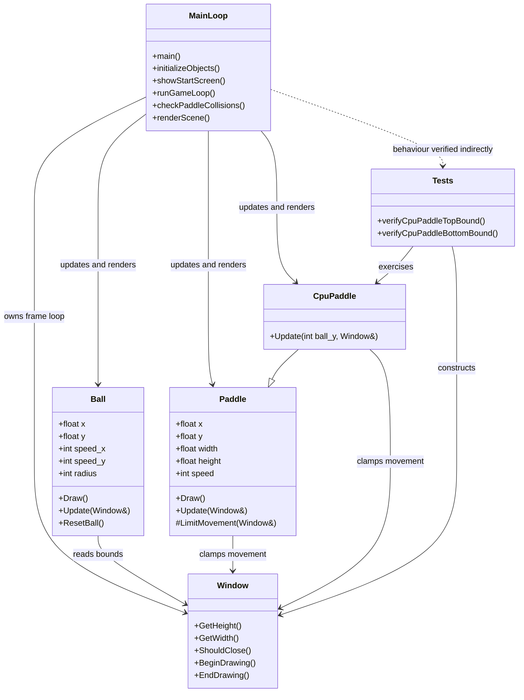

# Pong Game Architecture

## Overview

This project implements a simple Pong game in C++ on top of `raylib-cpp`. The architecture approach is intentionally largely procedural: the application entry point creates the game objects, runs the start screen, then drives a frame-by-frame update and render loop until the window closes.

The codebase is split into three main concerns:

- `game-source-code/main.cpp`: application entry point, global game state, the `Ball` class, collision checks, scoring, start screen, and the main game loop.
- `game-source-code/Paddle.h` and `game-source-code/Paddle.cpp`: reusable paddle behaviour for the human player and the CPU paddle.
- `test-source-code/tests.cpp`: doctest-based unit tests for CPU paddle boundary handling.

## Architectural Style

The game follows a lightweight game-loop architecture:

1. Initialize the window and game objects.
2. Show a splash screen until the player presses Enter.
3. For each frame:
   - update the ball and paddles,
   - resolve paddle-ball collisions,
   - render the current scene,
   - repeat until the window is closed.

State is stored directly in a small number of game objects and a pair of global score variables.

## Main Components

### Application and Game Loop

`main.cpp` owns overall control flow. It is responsible for:

- creating the `raylib::Window`,
- configuring screen size and target FPS,
- initializing the `Ball`, `Paddle`, and `CpuPaddle` instances,
- loading the splash image resource,
- running the start screen loop,
- running the gameplay loop,
- checking ball-paddle collisions,
- drawing the background, ball, paddles, and scoreboard.

This makes `main.cpp` the gameplay coordinator.

### Ball

The `Ball` class is defined locally in `main.cpp`. It encapsulates:

- position: `x`, `y`,
- velocity: `speed_x`, `speed_y`,
- size: `radius`.

Its responsibilities are:

- drawing itself,
- moving every frame,
- bouncing off the top and bottom of the window,
- detecting when it exits the left or right edge,
- updating the global score counters,
- resetting itself to the center with randomized direction.

The ball does not check paddle collisions internally. That logic is handled externally by the main game loop.

### Paddle

`Paddle` is the base abstraction for a vertically moving paddle. It stores:

- position: `x`, `y`,
- size: `width`, `height`,
- movement speed: `speed`.

Its responsibilities are:

- drawing a rounded rectangle,
- responding to player keyboard input using the up and down arrow keys,
- clamping movement so the paddle stays within the window.

### CpuPaddle

`CpuPaddle` inherits from `Paddle` and replaces player input with simple tracking behaviour. Each frame it compares its vertical midpoint to the ball's `y` position and moves up or down accordingly. It inherits the boundary limiting logic.

This is a simple "AI" controller.

### Rendering Layer

Rendering is performed directly through `raylib-cpp` calls. There is no dedicated renderer class. The render path includes:

- window background and court,
- center line and center circle,
- splash image and start text,
- ball and paddles,
- score text.

Because rendering code lives mostly in `main.cpp` and in each object's `Draw()` method, presentation and gameplay logic are only partially separated.

### Testing

The test suite uses doctest and currently verifies one narrow slice of behaviour: `CpuPaddle` must remain inside the top and bottom window bounds. These tests exercise:

- `CpuPaddle::Update(...)`,
- inherited movement limiting through `Paddle::LimitMovement(...)`.

There are no automated tests yet for ball scoring, ball reset behaviour, collision response, or the start screen/game loop.

## Data and Control Flow

At runtime, frame control flows as follows:

1. `main()` initializes the window and objects.
2. The start screen loop waits for Enter.
3. The gameplay loop updates the ball first.
4. The player paddle reads keyboard input and moves.
5. The CPU paddle tracks the ball's vertical position and moves.
6. The main loop checks ball collision against both paddles.
7. The scene is redrawn from current state.

Scoring is driven by the ball reaching the left or right screen edge. When that happens, `Ball::Update(...)` increments one of the global score variables and resets the ball.

## Overall UML Diagram

## Architectural Observations

- `Ball` being defined inside `main.cpp` keeps the project simple, but it also couples domain logic to the application entry point.
- Global score variables, although easy to use, significantly increase the possibility that hard-to-track down bugs will occur if modifications are made.
- `main()` has multiple responsibilities which should be delegated to dedicated classes.
