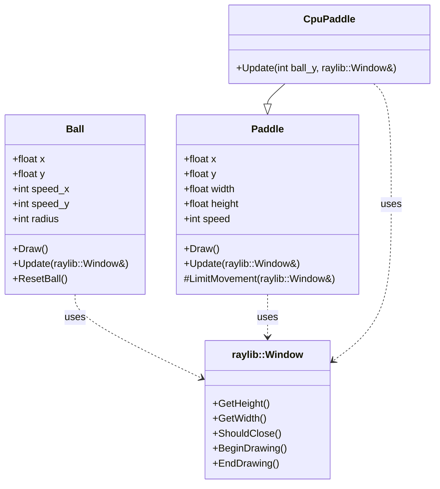
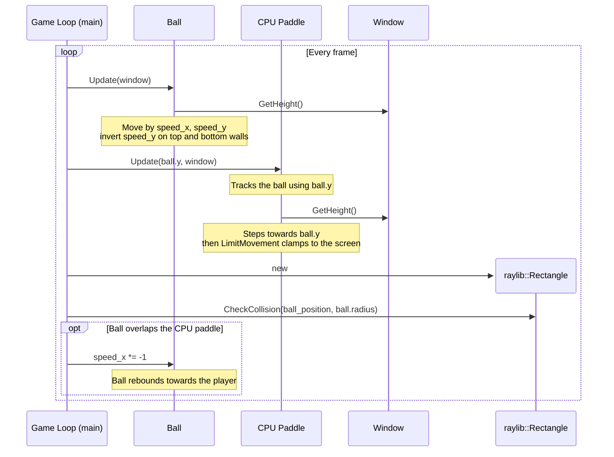

# Pong Game Architecture

## Domain Model

### Game Entities

The system models a two-sided Pong match. The game entities are represented
and drawn using simple shapes: the ball is modelled as a circle, while the
player and CPU paddles are modelled as rectangles. These shapes provide the
boundaries used to reason about movement and interaction within the court.

### Ball Movement and Deflection

The ball moves across the court, bounces off the top and bottom boundaries,
and changes direction when it contacts a paddle. The deflection angle is
determined by the ball's existing direction of travel, not by where it strikes
the paddle or by the paddle's movement. A paddle hit reverses the ball's
horizontal speed while leaving its vertical speed unchanged, so the ball's
angle of incidence equals the angle of reflection. Similarly, contact with the
top or bottom boundary reverses only the vertical speed. The angle can change
only when the ball is reset after a point is scored, as its horizontal and
vertical directions are randomly selected.

### Ball-Paddle Collision Detection

For a ball-paddle collision, the nearest point on the rectangular paddle to
the centre of the circular ball is considered. This point may be on an edge or
at a corner. If the distance to that point is less than or equal to the ball's
radius, the ball touches or overlaps the paddle and a collision is detected.

### Court Boundary Constraints

The paddle's interaction with the court is handled as a movement constraint
rather than as a collision with a solid object. After a paddle moves
vertically, its top edge is checked against the court's top boundary and its
bottom edge against the court's bottom boundary. If either edge would cross
its boundary, the paddle is placed at the nearest position that keeps its
entire height inside the court.

The ball's interaction with the top and bottom court boundaries is detected by
checking whether its edge reaches or passes a boundary. When this happens,
the ball's vertical direction is reversed. The left and right boundaries act
as scoring boundaries: when the ball passes one, the appropriate participant
receives a point and the ball is reset to the centre.

### Frame Rate and Timing

Movement is updated once per game frame, and the game is intended to run at
60 frames per second. The ball and paddles move by fixed distances per frame,
rather than by distances calculated from elapsed time. At the intended frame
rate this produces their designed speeds, but a lower frame rate makes them
travel less distance per second and a higher frame rate makes them travel more.
The game therefore relies on maintaining its target frame rate for consistent
movement and collision timing.

## Overall Class Diagram

> **Note:** Third-party dependencies (here, `raylib::Window` from raylib-cpp) are not normally illustrated in a class diagram; the Window is included only because it plays a major role in how these game classes work.

## Key Game Interaction: The Ball and the CPU Paddle

One of the most important interactions between game objects is the CPU paddle tracking
the ball and the ball rebounding off it. Each frame the game loop updates the
ball, then passes the ball's vertical position to `CpuPaddle::Update(...)` so
the paddle can follow it. The game loop then tests the ball against the CPU
paddle's bounds and, on a hit, reverses the ball's horizontal direction. The
player's paddle follows the same collision-and-rebound pattern.

