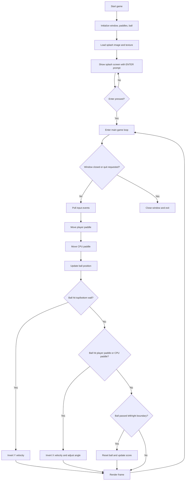
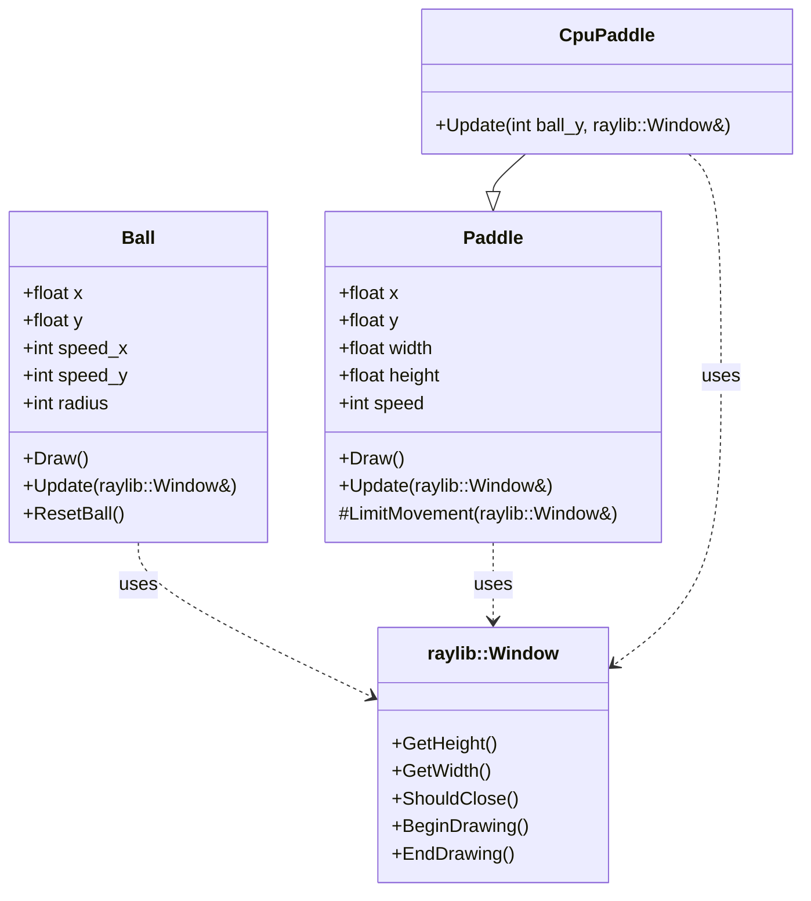
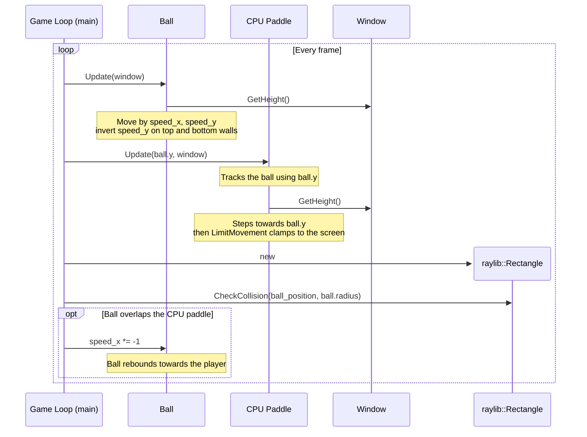

# Pong Game Architecture

## Overview

This project implements a simple Pong game in C++ on top of `raylib-cpp`. The architecture approach is intentionally largely procedural: the application entry point creates the game objects, runs the start screen, then drives a frame-by-frame update and render loop until the window closes.

The codebase is split into three main concerns:

- `game-source-code/main.cpp`: application entry point, global game state, the `Ball` class, collision checks, scoring, start screen, and the main game loop.
- `game-source-code/Paddle.h` and `game-source-code/Paddle.cpp`: reusable paddle behaviour for the human player and the CPU paddle.
- `test-source-code/tests.cpp`: doctest-based unit tests for CPU paddle boundary handling.

## Main Components

### Application Logic and Game Loop

`main.cpp` owns overall control flow and runs the game loop.

State is stored directly in a small number of game objects and a pair of global score variables.

### [Ball](class_ball.html)

Handles movement, boundary collisions, scoring, and reset behaviour. Defined locally in `main.cpp`. Scoring is driven by the ball reaching the left or right screen edge. When that happens, `Ball::Update(...)` increments one of the global score variables and resets the ball.

### [Paddle](class_paddle.html)

Base abstraction for a vertically moving paddle: draws itself, responds to arrow-key input, and clamps within the window.

### [CpuPaddle](class_cpu_paddle.html)

Extends `Paddle`, tracking the ball's vertical position instead of using keyboard input.

### Presentation Layer

Rendering is performed directly through `raylib-cpp` calls; there is no dedicated renderer class.

## Game Loop Control Flow

At runtime, the game follows a typical game loop.

1. Initialize the window and game objects.
2. Show a splash screen until the player presses Enter.
3. For each frame:
   - update the ball and paddles,
   - resolve paddle-ball collisions,
   - render the current scene,
   - repeat until the window is closed.

This is illustrated below:

## Overall Class Diagram

> **Note:** Third-party dependencies (here, `raylib::Window` from raylib-cpp) are not normally illustrated in a class diagram; the Window is included only because it plays a major role in how these game classes work.

## Key Game Interaction: The Ball and the CPU Paddle

One of the most important interactions between game objects is the CPU paddle tracking
the ball and the ball rebounding off it. Each frame the game loop updates the
ball, then passes the ball's vertical position to `CpuPaddle::Update(...)` so
the paddle can follow it. The game loop then tests the ball against the CPU
paddle's bounds and, on a hit, reverses the ball's horizontal direction. The
player's paddle follows the same collision-and-rebound pattern.

